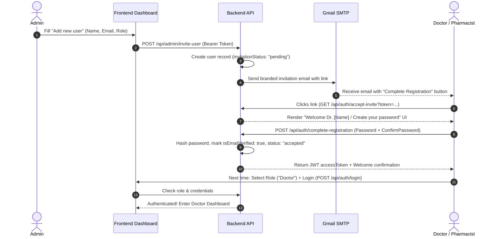

# 🩺 MedTrail API – Endpoints & Frontend Integration Guide

> **Base URL:** `http://localhost:3000/api`  
> **Interactive Swagger UI:** `http://localhost:3000/api/docs`  
> **Auth Scheme:** Bearer JWT token (`Authorization: Bearer <accessToken>`)

---

## 📌 Table of Contents
1. [Overview of the User Invitation & Onboarding Flow](#1-overview-of-the-user-invitation--onboarding-flow)
2. [Admin Endpoints (`/api/admin`)](#2-admin-endpoints-apiadmin)
   - [POST `/api/admin/invite-user`](#post-apiadmininvite-user)
   - [GET `/api/admin/invited-users`](#get-apiadmininvited-users)
   - [POST `/api/admin/resend-invitation/:id`](#post-apiadminresend-invitationid)
   - [GET `/api/admin/dashboard`](#get-apiadmindashboard)
   - [GET `/api/admin/users`](#get-apiadminusers)
   - [DELETE `/api/admin/users/:id`](#delete-apiadminusersid)
3. [Authentication & Registration Endpoints (`/api/auth`)](#3-authentication--registration-endpoints-apiauth)
   - [GET `/api/auth/accept-invite`](#get-apiauthaccept-invite)
   - [GET `/api/auth/validate-invitation`](#get-apiauthvalidate-invitation)
   - [POST `/api/auth/complete-registration`](#post-apiauthcomplete-registration)
   - [POST `/api/auth/login`](#post-apiauthlogin)
   - [POST `/api/auth/register`](#post-apiauthregister)
   - [POST `/api/auth/verify-email`](#post-apiauthverify-email)
   - [POST `/api/auth/resend-email-otp`](#post-apiauthresend-email-otp)
   - [POST `/api/auth/forgot-password`](#post-apiauthforgot-password)
   - [POST `/api/auth/verify-reset-code`](#post-apiauthverify-reset-code)
   - [POST `/api/auth/reset-password`](#post-apiauthreset-password)
4. [Frontend Wiring Checklist (What Needs to Be Connected)](#4-frontend-wiring-checklist)

---

## 1. Overview of the User Invitation & Onboarding Flow



---

## 2. Admin Endpoints (`/api/admin`)

> [!IMPORTANT]
> All admin endpoints require a valid JWT token with `role: "admin"` in the header:  
> `Authorization: Bearer <admin_access_token>`

### `POST /api/admin/invite-user`
Invites a new doctor or pharmacist. Creates a pending account and sends the invitation email.

- **URL:** `/api/admin/invite-user`
- **Method:** `POST`
- **Auth Required:** Yes (`Bearer <token>`, role: `admin`)
- **Headers:**
  ```http
  Content-Type: application/json
  Authorization: Bearer <accessToken>
  ```
- **Request Body:**
  ```json
  {
    "name": "Dr. Adewale Okafor",
    "email": "adewale@hospital.com",
    "role": "doctor",
    "hospitalName": "Lagos University Teaching Hospital",
    "phone": "+2348012345678"
  }
  ```
  *(Note: `role` must be `"doctor"` or `"pharmacist"`. Uppercase e.g. `"Doctor"` is automatically normalized).*
- **Success Response (`201 Created`):**
  ```json
  {
    "message": "Invitation sent successfully to adewale@hospital.com. The account is pending activation.",
    "invitationToken": "e4b2d56a-7f12-4c89-a032-11bfae9124cc",
    "invitationLink": "http://localhost:3000/api/auth/accept-invite?token=e4b2d56a-7f12-4c89-a032-11bfae9124cc",
    "browserInviteUrl": "http://localhost:3000/api/auth/accept-invite?token=e4b2d56a-7f12-4c89-a032-11bfae9124cc",
    "frontendInviteUrl": "http://localhost:5173/accept-invite?token=e4b2d56a-7f12-4c89-a032-11bfae9124cc",
    "user": {
      "id": "c1f7b7e3-0d34-4b55-a50e-5bb55387d8df",
      "name": "Dr. Adewale Okafor",
      "email": "adewale@hospital.com",
      "role": "doctor",
      "invitationStatus": "pending"
    }
  }
  ```
- **Error Responses:**
  - `400 Bad Request`: Validation error (invalid email format, invalid phone, missing name).
  - `401 Unauthorized`: Missing or invalid JWT token.
  - `403 Forbidden`: User is not an admin.
  - `409 Conflict`: An account with this email already exists.

---

### `GET /api/admin/invited-users`
Lists all invited users, filtered by their invitation status (`pending` or `accepted`).

- **URL:** `/api/admin/invited-users`
- **Method:** `GET`
- **Auth Required:** Yes (`admin`)
- **Success Response (`200 OK`):**
  ```json
  [
    {
      "id": "c1f7b7e3-0d34-4b55-a50e-5bb55387d8df",
      "name": "Dr. Adewale Okafor",
      "email": "adewale@hospital.com",
      "role": "doctor",
      "invitedRole": "doctor",
      "hospitalName": "Lagos University Teaching Hospital",
      "phone": "+2348012345678",
      "invitationStatus": "pending",
      "invitationTokenExpiry": "2026-10-18T01:30:00.000Z",
      "isEmailVerified": false,
      "invitedBy": "Samuel (e6690dc8-2778-4632-b7e4-2af79ae5531c)",
      "createdAt": "2026-10-16T01:30:00.000Z"
    }
  ]
  ```

---

### `POST /api/admin/resend-invitation/:id`
Regenerates an invitation token (valid for 48 hours) and resends the email to a pending doctor/pharmacist.

- **URL:** `/api/admin/resend-invitation/:id`
- **Method:** `POST`
- **Param:** `:id` (UUID of the user)
- **Auth Required:** Yes (`admin`)
- **Success Response (`200 OK`):**
  ```json
  {
    "message": "Invitation resent to adewale@hospital.com successfully.",
    "invitationToken": "d3c1a2f4-...",
    "browserInviteUrl": "http://localhost:3000/api/auth/accept-invite?token=d3c1a2f4-..."
  }
  ```
- **Error Responses:**
  - `404 Not Found`: User does not exist.
  - `409 Conflict`: User has already accepted and completed their registration.

---

### `GET /api/admin/dashboard`
Returns live statistical metrics for the admin overview dashboard cards.

- **URL:** `/api/admin/dashboard`
- **Method:** `GET`
- **Auth Required:** Yes (`admin`)
- **Success Response (`200 OK`):**
  ```json
  {
    "totalUsers": 24,
    "doctorsCount": 8,
    "pharmacistsCount": 5,
    "patientsCount": 10,
    "adminsCount": 1,
    "pendingInvitations": 3,
    "acceptedInvitations": 10
  }
  ```

---

### `GET /api/admin/users`
Returns all users in the system (Doctors, Pharmacists, Patients, Admins).

- **URL:** `/api/admin/users`
- **Method:** `GET`
- **Auth Required:** Yes (`admin`)
- **Success Response (`200 OK`):** Array of all user objects.

---

### `DELETE /api/admin/users/:id`
Deletes a user account from the system.

- **URL:** `/api/admin/users/:id`
- **Method:** `DELETE`
- **Param:** `:id` (UUID of the user)
- **Auth Required:** Yes (`admin`)
- **Success Response (`200 OK`):**
  ```json
  {
    "message": "User deleted successfully"
  }
  ```

---

## 3. Authentication & Registration Endpoints (`/api/auth`)

### `GET /api/auth/accept-invite`
Dual-mode endpoint:
- **In Chrome (Accept: `text/html`):** Renders the full interactive **"Welcome Dr. [Name]"** screen where the user enters and confirms their password.
- **In JSON API Client (Accept: `application/json`):** Returns the user's name and role for programmatic frontend rendering.

- **URL:** `/api/auth/accept-invite?token=<token>`
- **Method:** `GET`
- **Auth Required:** Public (None)
- **Query Param:** `token` (UUID)
- **JSON Response (`200 OK`):**
  ```json
  {
    "valid": true,
    "name": "Dr. Adewale Okafor",
    "email": "adewale@hospital.com",
    "role": "doctor"
  }
  ```

---

### `GET /api/auth/validate-invitation`
JSON-only validation endpoint (alias for `accept-invite`).

- **URL:** `/api/auth/validate-invitation?token=<token>`
- **Method:** `GET`
- **Auth Required:** Public (None)

---

### `POST /api/auth/complete-registration`
Called when the invited user sets their password. Activates the account, hashes the password, marks email as verified, invalidates the token, and returns a JWT `accessToken`.

- **URL:** `/api/auth/complete-registration`
- **Method:** `POST`
- **Auth Required:** Public (None)
- **Headers:** `Content-Type: application/json`
- **Request Body:**
  ```json
  {
    "token": "e4b2d56a-7f12-4c89-a032-11bfae9124cc",
    "password": "Password@123",
    "confirmPassword": "Password@123"
  }
  ```
- **Success Response (`200 OK`):**
  ```json
  {
    "message": "Registration complete! Welcome to MedTrail.",
    "accessToken": "eyJhbGciOiJIUzI1NiIsInR5cCI6...",
    "user": {
      "id": "c1f7b7e3-0d34-4b55-a50e-5bb55387d8df",
      "name": "Dr. Adewale Okafor",
      "email": "adewale@hospital.com",
      "role": "doctor",
      "hospitalName": "Lagos University Teaching Hospital",
      "phone": "+2348012345678"
    }
  }
  ```
- **Error Responses:**
  - `400 Bad Request`: "Passwords do not match. Please try again."
  - `400 Bad Request`: "This invitation link has expired. Please ask your administrator to send a new one."
  - `400 Bad Request`: "Registration already completed. Please log in with your credentials."

---

### `POST /api/auth/login`
Role-aware login. Verifies email, password, and enforces that the user logs in under their registered role.

- **URL:** `/api/auth/login`
- **Method:** `POST`
- **Auth Required:** Public (None)
- **Request Body:**
  ```json
  {
    "email": "adewale@hospital.com",
    "password": "Password@123",
    "role": "doctor"
  }
  ```
- **Success Response (`200 OK`):**
  ```json
  {
    "message": "Login successful",
    "accessToken": "eyJhbGciOiJIUzI1NiIsInR5cCI6...",
    "user": {
      "id": "c1f7b7e3-0d34-4b55-a50e-5bb55387d8df",
      "name": "Dr. Adewale Okafor",
      "email": "adewale@hospital.com",
      "role": "doctor",
      "hospitalName": "Lagos University Teaching Hospital",
      "phone": "+2348012345678"
    }
  }
  ```
- **Role Enforcement Protection:**
  - If Dr. Adewale selects `pharmacist` or `patient`, the backend blocks with:
    > `401 Unauthorized: "Your account is registered as a doctor. Please select the doctor role to log in."`
  - If an invited doctor has not set their password yet:
    > `401 Unauthorized: "Please complete your registration first by clicking the invitation link sent to your email."`

---

### `POST /api/auth/register`
Self-service registration for general accounts.

- **URL:** `/api/auth/register`
- **Request Body:** `{ "name": "...", "email": "...", "password": "...", "role": "patient" }`
- **Success Response (`201 Created`):** Sends 6-digit OTP to the email.

---

### `POST /api/auth/verify-email`
Verifies the 6-digit email OTP.

- **URL:** `/api/auth/verify-email`
- **Request Body:** `{ "email": "...", "otp": "123456" }`
- **Success Response (`200 OK`):** `{ "message": "Email verified successfully. You can now log in." }`

---

### `POST /api/auth/forgot-password`
Requests a 6-digit password reset OTP.

- **URL:** `/api/auth/forgot-password`
- **Request Body:** `{ "email": "..." }`
- **Success Response (`200 OK`):** `{ "message": "If an account exists with this email, a reset code has been sent." }`

---

### `POST /api/auth/verify-reset-code`
Validates that the reset OTP is correct and unexpired.

- **URL:** `/api/auth/verify-reset-code`
- **Request Body:** `{ "email": "...", "otp": "123456" }`

---

### `POST /api/auth/reset-password`
Sets the new password using the verified OTP.

- **URL:** `/api/auth/reset-password`
- **Request Body:** `{ "email": "...", "otp": "123456", "newPassword": "NewPassword@123" }`

---

## 4. Frontend Wiring Checklist

When you are ready to connect the frontend to the backend, here is the exact mapping needed:

| Frontend Component | Action Needed | Backend Endpoint to Connect |
|---|---|---|
| [`AddUserModal.jsx`](file:///c:/Users/Sam/Desktop/capstone%201/capstone-project-group-2/client/src/admin/components/AddUserModal.jsx) | Replace local `newDemoUser` object submission with `fetch('/api/admin/invite-user')` | `POST /api/admin/invite-user` |
| [`AdminUsers.jsx`](file:///c:/Users/Sam/Desktop/capstone%201/capstone-project-group-2/client/src/admin/pages/AdminUsers.jsx) | Fetch live users on load instead of `demoUsers` state | `GET /api/admin/invited-users` and `GET /api/admin/users` |
| [`AdminUsers.jsx`](file:///c:/Users/Sam/Desktop/capstone%201/capstone-project-group-2/client/src/admin/pages/AdminUsers.jsx) | "Resend invitation" button | `POST /api/admin/resend-invitation/:id` |
| [`AdminUsers.jsx`](file:///c:/Users/Sam/Desktop/capstone%201/capstone-project-group-2/client/src/admin/pages/AdminUsers.jsx) | "Delete user" button | `DELETE /api/admin/users/:id` |
| [`AdminDashboard.jsx`](file:///c:/Users/Sam/Desktop/capstone%201/capstone-project-group-2/client/src/admin/pages/AdminDashboard.jsx) | Connect metrics cards to live counts | `GET /api/admin/dashboard` |
| New Route: `/accept-invite` in [`App.jsx`](file:///c:/Users/Sam/Desktop/capstone%201/capstone-project-group-2/client/src/App.jsx) | If you want the frontend to host the invite page instead of backend HTML | `GET /api/auth/validate-invitation` & `POST /api/auth/complete-registration` |

---

### Example: Frontend Code Snippet for `AddUserModal.jsx`

```javascript
// Example helper for connecting AddUserModal to the backend:
async function handleInviteUser(userData) {
  const token = getAccessToken(); // from auth session
  
  const response = await fetch('http://localhost:3000/api/admin/invite-user', {
    method: 'POST',
    headers: {
      'Content-Type': 'application/json',
      'Authorization': `Bearer ${token}`
    },
    body: JSON.stringify({
      name: userData.name,
      email: userData.email,
      role: userData.role.toLowerCase(), // 'doctor' or 'pharmacist'
      phone: userData.phone,
      hospitalName: userData.hospitalName
    })
  });

  const data = await response.json();
  if (!response.ok) {
    throw new Error(data.message || 'Failed to invite user');
  }
  return data;
}
```

---

## 🩺 6. Doctor Module Endpoints

All endpoints require `Authorization: Bearer <token>` where the user has role `doctor`.

### `GET /api/doctor/dashboard`
Returns live metrics, recent patients, and recent clinical activities for the doctor's hospital.
- **Headers:** `Authorization: Bearer <jwt_token>`
- **Response `200 OK`:**
```json
{
  "doctor": {
    "id": "71c70fde-4f64-4790-9c1b-07764e26f931",
    "name": "Dr. Adewale",
    "email": "doctor@hospital.com",
    "role": "doctor",
    "hospitalName": "General Hospital"
  },
  "stats": {
    "patients": 22,
    "awaitingClarification": 12,
    "prescriptions": 23
  },
  "recentPatients": [
    {
      "id": "502d43af-cf3d-4488-af18-ae612c77af97",
      "name": "Miss. Jennifer",
      "email": "jennifer@generalhospital.com",
      "phone": "08123456789",
      "gender": "Female",
      "age": 34,
      "initials": "MJ",
      "lastPrescription": {
        "medicationName": "Amoxicillin",
        "date": "2026-10-17T00:32:41.004Z",
        "formattedDate": "17 Oct, 26, 12:32am",
        "status": "active"
      }
    }
  ],
  "recentActivities": [...]
}
```

---

### `GET /api/doctor/patients`
List all patients in the doctor's hospital matching Figma table:
Columns: `Name` | `Email` | `Phone` | `Current Medications` (count)
- **Query Parameters:**
  - `search` (optional): search by patient name, email, or phone.
  - `filter` (optional): `active` / `has_active`, `all`, `female`, `male`.
- **Response `200 OK`:**
```json
[
  {
    "id": "502d43af-cf3d-4488-af18-ae612c77af97",
    "name": "Miss. Jennifer",
    "email": "jennifer@generalhospital.com",
    "phone": "08123456789",
    "gender": "Female",
    "age": 34,
    "initials": "MJ",
    "hospitalName": "General Hospital",
    "currentMedications": 2,
    "currentMedicationsCount": 2,
    "totalPrescriptions": 3,
    "lastPrescription": {
      "medicationName": "Amoxicillin",
      "status": "active",
      "date": "17 Oct, 26, 12:32am",
      "createdAt": "2026-10-17T00:32:41.004Z"
    },
    "createdAt": "2026-10-17T00:32:30.000Z"
  }
]
```

---

### `GET /api/doctor/patients/:id`
Patient details header and partitioned tabs: **Current medications** (`active`, `pending`) and **Medication history** (`discontinued`, `completed`, `dispensed`, etc.).
- **Response `200 OK`:**
```json
{
  "patient": {
    "id": "502d43af-cf3d-4488-af18-ae612c77af97",
    "name": "Miss. Jennifer",
    "initials": "MJ",
    "email": "jennifer@generalhospital.com",
    "phone": "08123456789",
    "gender": "Female",
    "age": 34,
    "subtitle": "34 years old • Female",
    "hospitalName": "General Hospital"
  },
  "currentMedications": [
    {
      "id": "ca39a265-b939-4fdc-9138-cb4a0ad3c524",
      "medicationName": "Amoxicillin",
      "dosage": "500mg",
      "frequency": "3 times daily",
      "doseAndFrequency": "500mg, 3 times daily",
      "duration": "7 days",
      "reason": "Bacterial infection",
      "status": "active",
      "prescribedBy": "Dr. Adewale",
      "date": "17 Oct, 26, 12:32am"
    }
  ],
  "medicationHistory": [
    {
      "id": "...",
      "medicationName": "Paracetamol",
      "dosage": "500mg",
      "frequency": "1 tablet",
      "doseAndFrequency": "500mg, 1 tablet",
      "duration": "3 days",
      "reason": "Headache",
      "status": "discontinued",
      "prescribedBy": "Dr. Richardson",
      "date": "17 Oct, 26, 12:32am"
    }
  ],
  "currentMedicationsCount": 1,
  "medicationHistoryCount": 1,
  "totalPrescriptions": 2
}
```

---

### `POST /api/doctor/prescriptions/check-duplicate`
**MedTrailNG Exact Duplicate Detection** (Figma Frames 38 & 39):
Checks if proposed prescription exactly matches any existing `active` or `pending` prescription for the patient.
- **Request Body:**
```json
{
  "patientId": "502d43af-cf3d-4488-af18-ae612c77af97",
  "medicationName": "Amoxicillin",
  "dosage": "500mg",
  "frequency": "3 times daily",
  "duration": "7 days",
  "reason": "Bacterial infection"
}
```
- **Response if Duplicate Found (Frame 39):**
```json
{
  "isDuplicate": true,
  "message": "Duplicate found",
  "warningText": "MedTrailNG checks for exact duplicates only. It supports your decision and does not replace it.",
  "inReview": {
    "medicationName": "Amoxicillin",
    "dosage": "500mg",
    "frequency": "3 times daily",
    "duration": "7 days",
    "reason": "Bacterial infection"
  },
  "existing": {
    "id": "ca39a265-b939-4fdc-9138-cb4a0ad3c524",
    "medicationName": "Amoxicillin",
    "dosage": "500mg",
    "frequency": "3 times daily",
    "duration": "7 days",
    "reason": "Bacterial infection",
    "status": "active",
    "prescribedBy": "Dr. Adewale",
    "date": "17 Oct, 26, 12:32am"
  }
}
```
- **Response if No Duplicate (Frame 38):**
```json
{
  "isDuplicate": false,
  "message": "No exact duplicate found",
  "warningText": "MedTrailNG checks for exact duplicates only. It supports your decision and does not replace it.",
  "inReview": {
    "medicationName": "Azithromycin",
    "dosage": "250mg",
    "frequency": "Once daily",
    "duration": "5 days",
    "reason": "Respiratory infection"
  },
  "existing": null
}
```

---

### `POST /api/doctor/prescriptions`
Submit prescription. Created in `status: pending` awaiting pharmacy approval.
- **Request Body:**
```json
{
  "patientId": "502d43af-cf3d-4488-af18-ae612c77af97",
  "medicationName": "Amoxicillin",
  "dosage": "500mg",
  "frequency": "3 times daily",
  "duration": "7 days",
  "reason": "Bacterial infection",
  "instructions": "Take after meals"
}
```
- **Response `201 Created`:**
```json
{
  "message": "Prescription created successfully and sent to pharmacy for review",
  "prescription": {
    "id": "ee035bbd-dc47-4529-bb37-7610fbd30c50",
    "hospitalName": "General Hospital",
    "patientId": "502d43af-cf3d-4488-af18-ae612c77af97",
    "patientName": "Miss. Jennifer",
    "medicationName": "Amoxicillin",
    "dosage": "500mg",
    "frequency": "3 times daily",
    "doseAndFrequency": "500mg, 3 times daily",
    "duration": "7 days",
    "reason": "Bacterial infection",
    "status": "pending",
    "date": "17 Oct, 26, 12:32am",
    "createdAt": "2026-10-17T00:32:50.000Z"
  }
}
```

---

### `GET /api/doctor/clarifications`
Prescriptions flagged by pharmacy awaiting doctor clarification.

### `POST /api/doctor/clarifications/:id/resolve`
Doctor resolves clarification with answer and returns it to pharmacy.
- **Body:** `{ "response": "Confirmed dosage of 500mg." }`

---

## 💊 7. Pharmacy Module Endpoints (`/api/pharmacy`)

Role: `pharmacist` or `admin`.

### `GET /api/pharmacy/dashboard`
Pharmacy dashboard metrics (total prescriptions, pending, awaiting clarification, dispensed).

### `GET /api/pharmacy/prescriptions`
Prescriptions queue for the hospital:
- **Query params:**
  - `status`: `pending`, `awaiting_clarification`, `clarified`, `dispensed`, `all`
  - `search`: search by patient name or medication name

### `POST /api/pharmacy/prescriptions/:id/dispense`
Pharmacist dispenses prescription (marks status as `dispensed`).

### `POST /api/pharmacy/prescriptions/:id/clarify`
Pharmacist flags an issue / questions doctor:
- **Body:** `{ "reason": "Patient noted penicillin allergy history. Please confirm alternative." }`
- Prescription status changes to `awaiting_clarification` and appears immediately in doctor's clarification queue!


